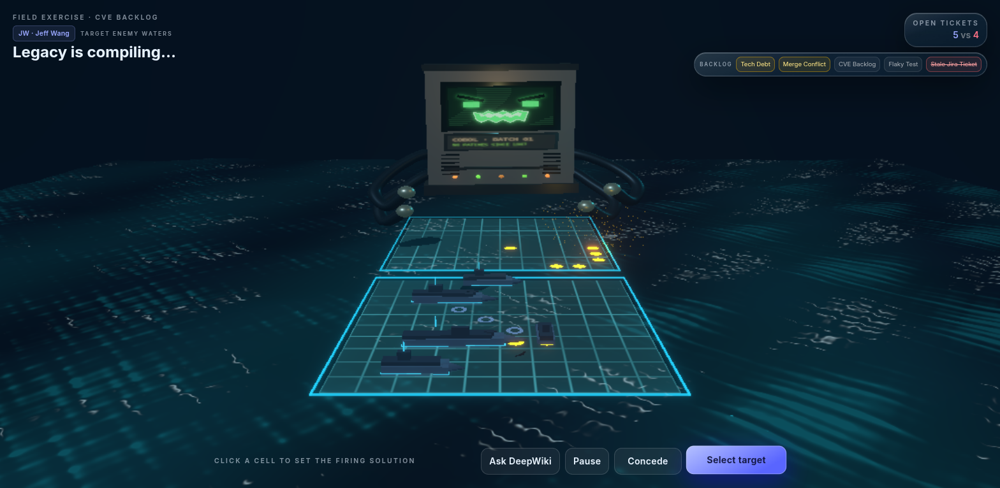
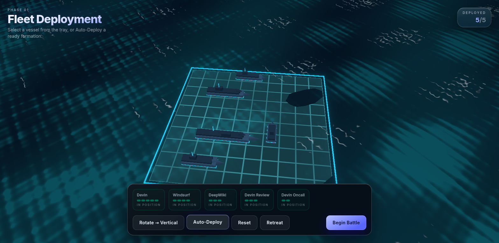
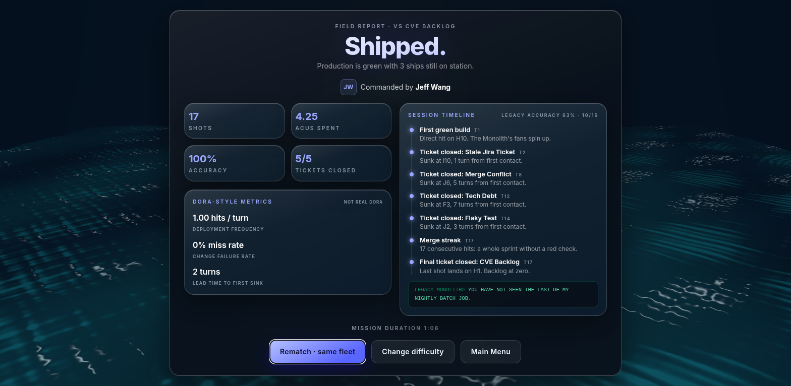
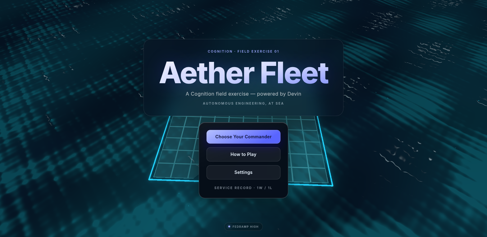
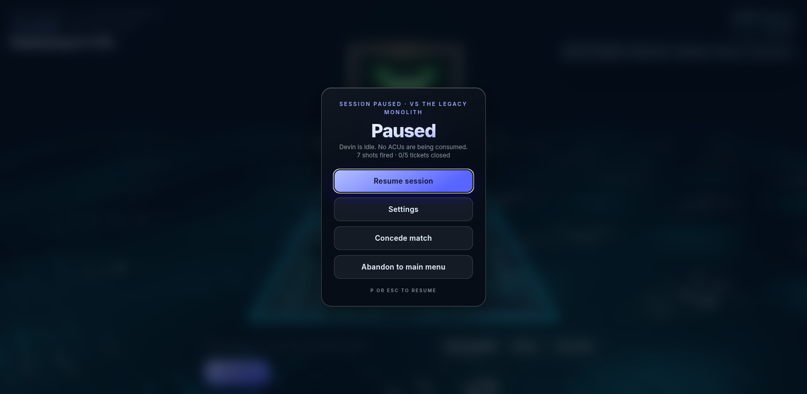
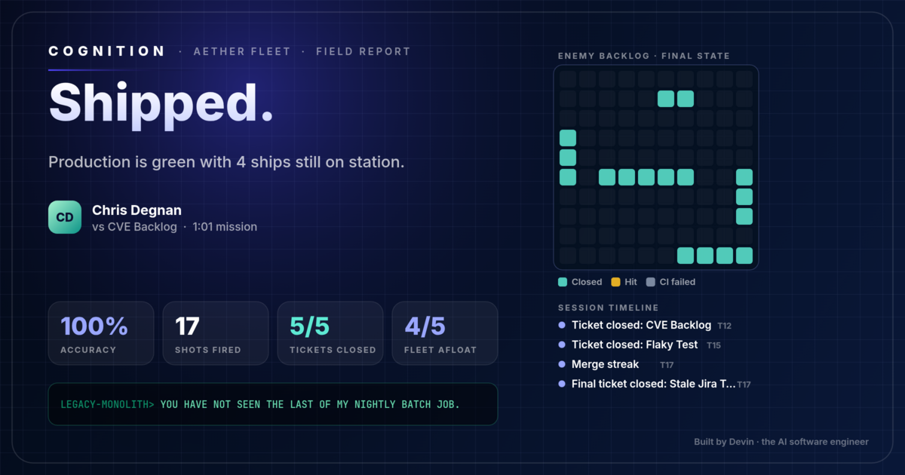

<div align="center">

# Aether Fleet

**The definitive 3D Battleship — a Cognition field exercise, built by Devin.**

Command a fleet of Devin products across a living GLSL ocean and close every ticket in the
backlog before the **Legacy Monolith**, a 40-year-old COBOL mainframe, rolls your fleet back.



`React 19` · `React Three Fiber` · `Three.js` · `GLSL` · `Zustand` · `Tailwind v4` · `Web Audio` · `TypeScript strict` · `Offline PWA`

</div>

---

## What it is

Classic Battleship rules, staged like a product launch:

| | |
|---|---|
| **Your fleet** | Devin (5), Windsurf (4), DeepWiki (3), Devin Review (3), Devin Oncall (2) |
| **The backlog** | Tech Debt, Merge Conflict, CVE Backlog, Flaky Test, Stale Jira Ticket |
| **The boss** | The Legacy Monolith — a sentient mainframe that glares over the enemy grid, reacts to every hit and trash-talks in COBOL |
| **Commanders** | Scott Wu, Chris Degnan, Jeff Wang or Will McCarthy (cosmetic, remembered between sessions) |
| **Difficulty** | Flaky Test → Merge Conflict → CVE Backlog → The Legacy Monolith (four real AI tiers, below) |

A hit is a merged PR, a miss is a failed CI run, a sunk ship is a closed ticket. Every match
ends with a **field report** that retells the match as a story: first green build, every
ticket closed, every regression, persistence streaks, and a parting shot from the Monolith.

The deciding shot gets a letterboxed finale (the Monolith's `JOB TERMINATED` defeat or its
victory gloat) before the report slides in; click, tap or press Space to skip it. The report's
**Share field report** button copies the match as plain text (Slack/PR-ready, with an ASCII
grid) and renders a Cognition-branded 1200×630 PNG card you can download or share.

| Deploy | Field report |
|---|---|
|  |  |
| **Main menu** | **Pause** |
|  |  |



## Play

```bash
npm install
npm run dev        # http://localhost:5173
```

| Key | Action |
|---|---|
| Click / tap | Deploy: place the selected ship (tap a placed ship to pick it up). Battle: aim at an enemy cell |
| **R** | Rotate the ship you're placing |
| **Enter** | Fire at the locked target · launch the battle once the fleet is deployed |
| **P** / **Esc** | Pause / resume (the game also pauses itself if you switch tabs) |

**Rematch** on the field report redeploys the exact same formation at the same difficulty, so
"one more game" is two clicks.

<details>
<summary><b>Easter eggs</b> (spoilers)</summary>

Type these anywhere outside a text field: `devin`, `cobol`, `lgtm`, `sudo`, `acu`, `wiki`,
`windsurf` — and the Konami code. The toast tracks how many of the eight you've found.
In battle, **Ask DeepWiki** serves real Devin product tips.

</details>

## How it's built

```
src/
  game/    pure TypeScript rules: board, 4-tier AI, match engine, match story  (no React/Three)
  state/   Zustand store (match flow, pausable turn timers, persistence) + fx event bus
  three/   R3F scene: GLSL ocean, grids, procedural ships, missiles, Legacy Monolith
  ui/      "liquid glass" HUD screens (Tailwind v4 + framer-motion)
  audio/   procedural Web Audio — every sound is synthesized, zero audio files
```

- **Engine is UI-free.** `src/game/` has no React or Three imports, so rules, AI and the
  match story are unit-tested in plain Node.
- **Renders without re-rendering.** Boards mutate in place and a `matchVersion` counter
  drives React; one-shot effects (missiles, splashes, explosions, sonar) go over a tiny pub/sub
  bus (`src/state/fx.ts`) so they never touch render state.
- **Turn flow is a pausable timeline.** Every delayed step of a turn (missile flight, the
  Monolith "compiling", the board review, the result reveal) runs through one `later()`
  scheduler in the store, so pause freezes a turn mid-flight and quitting cancels it cleanly —
  no stray timer can ever fire into the next match.
- **Four honest AI tiers** (`src/game/ai.ts`) — they only see the marks you'd see:
  - *Flaky Test*: random fire, 45% chance to chase a hit.
  - *Merge Conflict*: hunt/target with checkerboard parity.
  - *CVE Backlog*: full probability-density heat map over every legal remaining placement.
  - *The Legacy Monolith*: sharper, length-weighted density with endpoint boosts on hit runs.
- **Performance.** `AdaptiveDpr` scales resolution to hold frame rate, hit/miss markers are
  two `InstancedMesh` draws, bloom and ocean detail follow the performance setting.
- **PWA & accessibility.** Fully offline after first load (`vite-plugin-pwa`). Settings for
  volume, mute, reduced motion, high contrast and performance mode persist in `localStorage`
  along with your commander, per-difficulty record and easter eggs found.

### Quality gates

```bash
npm run lint       # eslint
npm run test       # vitest: rules, AI legality & strength, match story, full game-flow playthroughs
npx tsc -b         # strict type check
npm run build      # production build + service worker
```

`src/state/store.test.ts` plays complete matches on all four difficulties through the real
store with fake timers, and checks pause, quit-mid-turn and rematch — so a soft-lock fails CI
instead of a demo. `src/state/store.flow.test.ts` goes further on every difficulty: win, finale
hold, report, rematch, a second report, quit mid-AI-turn, a fresh game, and asserts that zero
game timers are left scheduled after each quit or rematch, that the mission clock excludes pause
time, and that skipping the finale is idempotent.

## How Devin built it

Aether Fleet was built end to end by [Devin](https://devin.ai), Cognition's autonomous AI
software engineer, working from plain-English direction:

1. **One session, first playable.** Devin scaffolded the engine, AI, GLSL ocean, glass UI,
   procedural audio and PWA, with tests, in a single pull request.
2. **Review in a real browser.** Every visual change was checked as rendered pixels in Chrome,
   not just "it compiles" — which is how black-blob ships, grid lines drawn through cell
   centres and an ocean shader that failed to compile on ANGLE were caught and fixed.
3. **Parallel specialists.** Later rounds ran several Devin sessions at once, each owning one
   area (visuals, ocean, boss, audio, UI, game flow & QA) on its own branch.
4. **Devin Review** checked pull requests; **DeepWiki** documents the codebase.

## Built by 7 Devins

The current version was built by a team of eight Devin sessions: seven specialists and one lead.

| Specialist | Owns |
|---|---|
| 3D art | Ship models, ocean and grid shaders, lighting |
| FX & boss | Missiles, splashes, explosions, the Legacy Monolith's moods and finale |
| AI engine | The four difficulty tiers (hunt/target, parity, probability density) |
| Audio | The procedural Web Audio score and sound effects |
| UI / HUD | Glass panels, HUD, menus, field report layout |
| Perf, mobile & PWA | Frame budget, touch controls, the offline service worker |
| Game flow, story & QA | Store and timers, match story, share card, end-to-end QA |

How the work was run:

1. **Round 1.** Every specialist worked at the same time on its own branch, staying in its
   own files so that seven people's work could be combined without collisions. Each one had to
   pass lint, tests, a strict type check and a production build, then play the game in a real
   browser and check the screenshots before pushing.
2. **Lead integration.** A lead Devin merged all seven branches into one, resolved the overlaps,
   played the combined game end to end, and wrote a direct critique of each area. Round 1
   was good, and the critique said it was not good enough yet.
3. **Round 2.** Each specialist fixed every point in its critique and then looked for
   improvements of its own. Shared contracts, such as the `bossMood` event that the boss emits
   and the audio and FX follow, were agreed in writing so parallel branches stayed compatible.
   The lead integrated round 2 the same way.

It works like a product team: specialists own their own areas, there is one integration owner,
and every change gets reviewed against what a user actually sees.

## Deploy

`npm run build` → static files in `dist/`. Host anywhere static (GitHub Pages, Netlify,
Vercel, S3). No backend, no API keys, no running costs.
